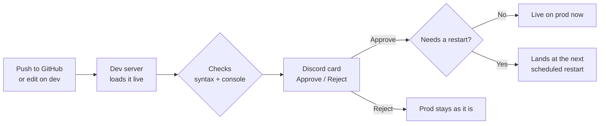

<div align="center">

# fxship

**Ship to your FiveM server from GitHub, with every change tested on dev and approved in Discord.**

Production and dev servers on one machine, a Discord card for every push,
and nothing reaches your players until someone presses **Approve**.

[](https://rivolabs.github.io/fxship/install/linux/)
[](https://rivolabs.github.io/fxship/install/windows/)
[](#works-with-any-server)
[](LICENSE)

[Install](#install) · [How it works](#how-a-change-reaches-players) · [Guide](https://rivolabs.github.io/fxship/) · [Used by](#used-by)

</div>

---

## Why

Most FiveM servers deploy by dragging files onto the live box and restarting. One typo takes the
city down, and nobody knows who changed what. fxship turns that into a pipeline your staff already
know how to use:

- **Push to GitHub, or just save a file on dev.** Either way, dev loads it within seconds.
- **Dev tests it for you.** Syntax is checked, the change is loaded on the dev server, and the
  console is read for new errors.
- **Discord asks for approval.** A card shows the commits, which resources change, the test results,
  and **Approve** and **Reject** buttons that only your approver roles can press.
- **Prod never kicks players for a deploy.** Changes that can load live go live. Anything that
  needs a restart (maps, vehicles, clothing, core scripts) waits for your next scheduled restart.

## How a change reaches players



## What you get

| Feature | What it does |
| --- | --- |
| **Dev and prod on one box** | Two FXServer + txAdmin instances. Dev is capped on CPU and memory so it can never starve prod. One IP or two, or prod only. |
| **Discord approvals** | Release cards with commits, changed resources, syntax and dev results. Role-gated buttons, plus `/deploy status`, `rollback`, `apply-now` and more. |
| **Edit on dev, ship from Discord** | Staff edit dev over a mapped drive or SSH. Dev reloads what changed, and **Ship** commits it to GitHub under their name. No 15 GB clone needed. |
| **Restart-aware deploys** | Streaming and core resources are detected automatically and wait for the next scheduled restart. Everything else goes live at once. |
| **Safe by default** | Dev uses its own database and never binds prod's port or takes prod's Tebex purchases. Admin pages stay on Tailscale. Staff can't touch prod or read secrets. |
| **Backups** | Nightly encrypted backups of both databases, configs and txAdmin data to S3, B2, SFTP or a local folder, with tested restores. |
| **One-command health check** | `fxship doctor` checks GitHub access, txAdmin, the Discord bot and roles, the restart schedule, disk, clock and backups, and tells you how to fix anything wrong. |
| **Quiet in Discord** | One live card per decision, paced edits, and no alert storms when dev restarts. |
| **White-label** | Your server's name and icon on every card. A small "Powered by Rivo" line can be switched off. |

## Install

You need a fresh **Ubuntu 24.04** or **Windows Server 2022/2025** machine, your server's resources
in a GitHub repo, a [Cfx.re license key](https://portal.cfx.re), and a Discord bot
([how to make one](https://rivolabs.github.io/fxship/guides/discord-bot/)).

**Ubuntu 24.04**, as root:

```bash
curl -fsSL https://github.com/RivoLabs/fxship/releases/latest/download/install.sh | sudo bash
```

**Windows Server 2022 / 2025**, in an elevated PowerShell:

```powershell
irm https://github.com/RivoLabs/fxship/releases/latest/download/install.ps1 | iex
```

The installer asks a few questions (it has a sensible default for each), sets everything up, and
finishes with `fxship doctor`. Run it again any time to change a setting: it only changes what's
different and never restarts a server with players on it.

New to git? [Put your server in git](https://rivolabs.github.io/fxship/guides/server-in-git/) first.

## Works with any server

fxship doesn't care which framework you run. It looks at your repo and works out:

- **Streaming resources** (anything with a `stream/` folder, `data_file` entries or `this_is_a_map`),
  so they always wait for a restart, whatever folder they're in.
- **Core resources** for Qbox, QBCore, ESX, ox_core, ND and vRP, plus the database and voice
  resources, so they wait for a restart too.
- **Your repo layout:** just the `resources` folder, or the whole `server-data` folder with
  `server.cfg`.

Run `fxship detect <folder>` to see what it finds. Anything can be overridden in one config file.

## Used by

<table>
  <tr>
    <td align="center" width="200">
      <a href="https://discord.gg/leonidastories"></a><br>
      <b><a href="https://discord.gg/leonidastories">Leonida Stories</a></b>
    </td>
    <td align="center" width="200">
      <br>
      <b>San Andreas Classics</b>
    </td>
  </tr>
</table>

Running fxship? Open an issue to be listed here.

## Everyday commands

```text
fxship status          what prod and dev run, and any release waiting
fxship approve         approve the waiting release (or press the button in Discord)
fxship rollback <sha>  move prod back to an earlier commit
fxship apply-now       land a queued release now, with a warning to players
fxship db-refresh      copy the prod database over dev's
fxship doctor          check the whole setup
fxship upgrade         update fxship
```

In Discord: `/deploy status`, `/deploy rollback`, `/deploy apply-now`, `/deploy poll`,
`/deploy refresh-dev-db`.

## Documentation

The [guide](https://rivolabs.github.io/fxship/) covers requirements, both installers, setting up
the Discord bot, the daily workflow, staff access, backups and restores, every setting,
troubleshooting, and why fxship is built the way it is. Its source is in [`docs/`](docs/src/content/docs).

## License

[MIT](LICENSE). Built by [RivoLabs](https://rivo.tools).
